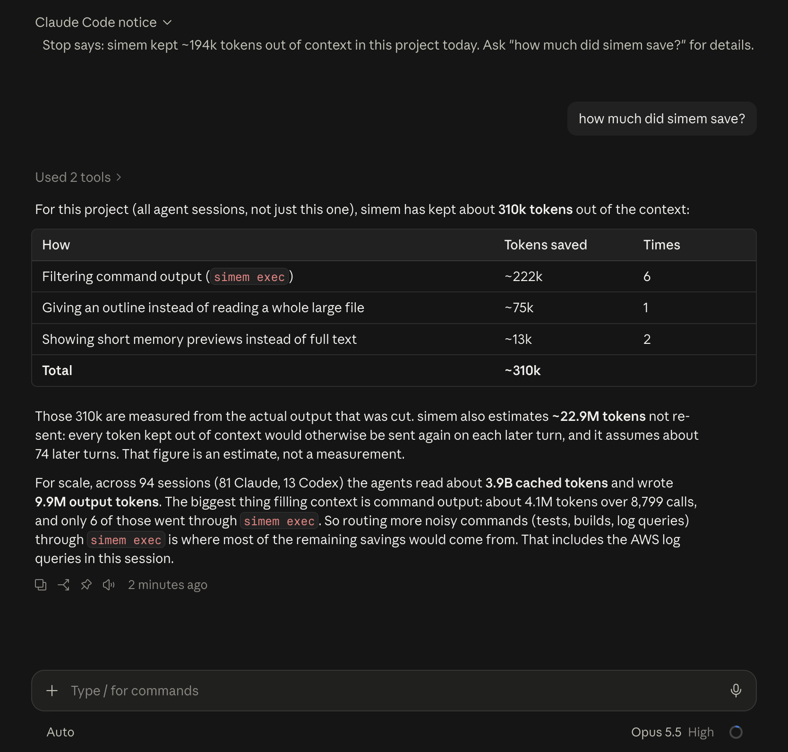

<p align="center"></p>

# simem — Super Intelligence Memory

**Spend fewer tokens. Never re-explain your project.**

simem is a **Super Intelligence Memory** for AI coding agents. It remembers what your agents learn about a project — decisions, constraints, preferences, how to build and test — and gives that memory to **every agent and every account** you use: Claude Code, Codex, and Cursor, in the desktop apps and the CLIs. It also keeps the noise (huge command outputs, whole-file reads, repeated context) out of what gets sent to the model. Everything runs on your machine.

*simem was called **mixai** until 2.0.*

[](https://www.npmjs.com/package/@simem/cli)
[](https://www.npmjs.com/package/@simem/cli)
[](LICENSE)
[](https://nodejs.org)

**npm:** [`@simem/cli`](https://www.npmjs.com/package/@simem/cli) · **command:** `simem` · **plugins:** Claude Code and Codex marketplace `thinhledev/simem`

## Install

Pick the app you use. Both routes end the same way: start a new session and say **"set up simem"** — the plugin's setup skill installs the simem CLI and runs `simem init` for you.

### Claude Code — plugin marketplace

In Claude Code (desktop app or CLI), run:

```text
/plugin marketplace add thinhledev/simem
/plugin install simem@simem
```

Or both at once with `/plugin install simem --marketplace thinhledev/simem` (Claude Code 2.1.275+). From a terminal:

```bash
claude plugin marketplace add thinhledev/simem
```
```bash
claude plugin install simem@simem
```

Updates: `claude plugin update simem@simem`, or turn on auto-update for the `simem` marketplace in `/plugin`.

### Codex — plugin marketplace

From a terminal (the Codex app uses the same configuration):

```bash
codex plugin marketplace add thinhledev/simem
```
```bash
codex plugin add simem@simem
```

Or inside Codex, open `/plugins` and install **simem** from the `simem` marketplace. Updates: `codex plugin marketplace upgrade`.

### Then: "set up simem"

Start a new session in either app and say **"set up simem"**. The agent asks before each step, installs the simem CLI (with npm if you have Node.js 22.5+, otherwise with Homebrew), shows what `simem init` will change, and runs it once you agree. `simem init` runs once per machine, not per project, and:

- connects simem to **every Claude Code and Codex account** on the machine (hooks + tools),
- imports this project's past sessions and the agents' own memories — **without spending a single token**,
- downloads a small local embedding model (31 MB, MIT-licensed, works offline after that).

Restart the apps afterwards (the Codex app asks you once to trust the new hooks). The plugins only add skills; hooks and tools come from `simem init`, so nothing is registered twice.

### Without the plugins

The npm package is [**`@simem/cli`**](https://www.npmjs.com/package/@simem/cli); the command it installs is **`simem`**. Paste this into Claude Code or Codex — or run it in a terminal (needs Node.js 22.5+):

> Install and set up simem: run `npm install -g @simem/cli && simem init`, then tell me to restart the app.

### Homebrew (macOS and Linux, no Node.js needed)

```bash
brew tap thinhledev/simem
```
```bash
brew trust --formula thinhledev/simem/simem
```
```bash
brew install simem
```
```bash
simem init
```

Homebrew brings its own Node.js, so this works without Node.js installed. Homebrew 6 installs from taps outside its own collection only after you trust them; the second command trusts just the simem formula. Upgrades (`brew upgrade simem`) keep working in the desktop apps without re-running `simem init`.

## The three problems it solves

**1. Every new session starts from scratch.** Without memory, a fresh session doesn't know what you built yesterday, what you decided, or how to run the tests. So the agent rediscovers it: listing folders, reading the README, searching and opening files — or you explain it all again. With simem, what earlier sessions learned stays on your computer and comes back on its own:

- **At the start of every new session**, the agent gets a short summary of the project: the latest work, the decisions still in force, the build and test commands that worked, and how the code is laid out. It starts knowing the basics instead of scanning the codebase for them.
- **With each message you send**, simem adds the saved notes that clearly match what you wrote — for example the reason you chose your database when you mention the database.
- **Whenever you or the agent asks** ("what did we decide about payments?"), it searches everything earlier sessions saved.

The agent may still open files to do the actual work; what it no longer needs is to rediscover the project each time.

**2. Memory is stuck in one app, one account, one folder.** Switch from Claude Code account A to account B, from Claude Code to Codex, open a new worktree, or re-clone the repo — and the agent starts from zero. simem's memory belongs to the **project**, not to an app or a login.

**3. Agents pay for the same text again and again.** Think of a conversation with your coding agent as a stack of paper. Every time you send a message, the whole stack goes to the AI, and the AI reads all of it again — and every page it reads costs money or uses up your plan's limit. Pages are only removed when the app compacts the conversation.

A lot of that stack is reports from tools the agent runs. Run the tests, and the report can be hundreds of lines, mostly "✓ passed, ✓ passed, ✓ passed…". That whole report goes on the stack and is read again on every turn after it.

simem trims those reports before they go on the stack. It keeps what matters — errors, failures, the summary — and keeps the full report on your computer in case the agent needs it later.

**Real numbers from this project** (32 work sessions in the Claude Code and Codex apps, measured from the apps' own records with `simem stats`):

- The AI read about **1.2 billion tokens** in total. A token is about ¾ of a word, so that's roughly 900 million words — the length of about 10,000 novels — mostly the same conversations being read again turn after turn.
- The biggest thing on the stack was **tool reports**: about 1.2 million tokens from 1,743 commands. Next came **files the agent opened**: about 430,000 tokens.

**What simem trims.** We took about 1,700 of those real reports and ran them through simem:

| | Before | After simem | Shorter by |
|---|---|---|---|
| All tool reports | 1.16M tokens | 0.90M tokens | **22%** |
| Test reports | 26k tokens | 14k tokens | **46%** |

Because the AI reads the stack again on every turn, each page simem removes is saved again on every later turn — the longer the conversation, the bigger the saving.

**Why only 22% here?** In this project the agent was already cutting most reports short itself, so there was less left to trim. When a report arrives in full — a complete test run or package install — simem cuts **81–99%** of it.

*In the Claude Code app, test, build, and install reports are trimmed automatically when your settings already let those commands run without asking; otherwise the agent can choose to use simem's trimming (`simem exec`). These are one project's numbers; your savings depend on your work. To measure your own projects: `node scripts/replay-filters.mjs`.*

## How it saves tokens

| What simem does | How | Measured as |
|---|---|---|
| **Project primer at session start** | A short, stable summary (latest work from any agent, standing decisions, build/test commands that worked, repo layout) instead of exploration turns. Byte-identical while memory is unchanged, so the provider's prompt cache keeps hitting. | — |
| **Shortened command output** | `simem exec -- <command>` drops ANSI codes, progress bars, passing-test lines, install chatter, and repeats — **never failure lines**. The full output stays on disk (`simem out <id>`). In Claude Code it's applied automatically to commands your own permission settings already allow. | Exact characters before/after. Test corpus: jest 92%, vitest 99%, pytest 81%, node:test 98%, go test 98%, npm install 99%; a wall of compiler *errors* is kept whole (0%) because every line is a failure. |
| **Local code search** | `code_search` returns `path:line-range` + signature instead of grep-then-read loops; `code_read` returns one function, not the whole file. | Exact for `code_read`; labelled estimate for `code_search`. |
| **Large-read and re-read guards** | A full read of a file over 800 lines gets its outline first (once — ask again and you get the file). Re-reading an unchanged file already in context is flagged once. | Exact; the saving is withdrawn if the agent reads the file anyway. |
| **Relevant memory, once** | Only memory that clearly matches your prompt is added, never twice in the same context window. | Characters injected. |
| **Secrets stay out** | API keys, tokens, private keys, and passwords are redacted from everything simem stores or shows. | Redaction count. |
| **Zero tokens to build memory** | Memory is extracted by local rules from what *you* said (decisions, constraints, preferences, corrections), plus the apps' own summaries. A local Ollama model or a remote agent are optional extras, off by default. | Provider calls by simem: 0. |

Ask your agent *"how much did simem save?"*, run `simem stats`, or open the dashboard. Every figure says whether it is **measured** or an **estimate**.

**What that looks like in a real session.** In Claude Code you don't have to remember to ask: simem's session hook shows a short notice on its own — once per session, when the agent finishes a reply and simem has saved at least 1k tokens in the project that day (the "Claude Code notice" at the top of the screenshot). Ask the question it suggests and the agent answers from simem's own records:

<p align="center"></p>

- **~310k tokens kept out of context, measured**, across every agent session in the project. Just 6 commands run through `simem exec` account for ~222k of it, and one large-read guard stopped a ~75k-token file read.
- **~22.9M tokens not re-sent, estimated** — because whatever stays out of context isn't sent again on every later turn.
- The agent also spots where more savings are: command output filled ~4.1M tokens over 8,799 calls, and only 6 of those had gone through `simem exec`.

## Memory that follows the project, not the account

```
 Claude Code app (account A) ─┐
 Claude Code app (account B) ─┤
 Codex app / CLI             ─┼──▶ ~/.simem/projects/<project-id>  ──▶ the same memory everywhere
 Cursor                      ─┤      (id = your repo's first commit:
 any worktree or clone       ─┘       same for every clone and worktree)
```

What survives: logging out and in, switching accounts, switching between Claude Code / Codex / Cursor, new worktrees, re-clones, renamed folders. New machine? `simem memory export` / `import`, or point `memory.syncDir` at a folder you already sync (iCloud, Dropbox) — optionally encrypted.

## Using it day to day — just ask

| Say to your agent | What happens |
|---|---|
| *"Why did we pick Postgres?"* | The `recall` tool searches memory (keywords + local embeddings) across every agent's past sessions. |
| *"Remember that we deploy only from CI."* | Saved as a decision; every agent and account sees it from now on. |
| *"Forget that."* | Archived; it won't come back, even if old transcripts mention it again. |
| *"How much did simem save this week?"* | Real token usage from your sessions, and what simem kept out — measured vs estimated. |
| *"Open the simem dashboard."* | A private page on your machine: usage, savings, and your memory to search, edit, forget, or apply to all projects. |
| *"Continue."* (in the other app) | Opening Codex after Claude Code (or vice versa) starts with the other app's latest work in the primer — no switch command, no copy-paste. |

Shortcuts from the plugin: **`/simem:stats`** (add `30d` or `all` for another period) and **`/simem:dashboard`** in Claude Code; `$simem:stats` and `$simem:dashboard` in Codex. They run only when you type them; Claude Code doesn't load them into the context until then.

Claude Code can also show today's savings in its status line: `simem init --statusline`.

## Privacy and safety

Full details: [PRIVACY.md](PRIVACY.md) · [TERMS.md](TERMS.md).


- **Local only.** Memory lives in `~/.simem`. Nothing is uploaded; there is no simem server.
- **No proxy, no credentials.** simem never sits between you and the model provider and never reads your logins. It works through the apps' own hooks and tool (MCP) interfaces.
- **Your permission settings stay in charge.** simem only shortens a command's output automatically when your settings would have allowed that command anyway; otherwise the agent is simply told how to use `simem exec`. The read guards only ever *decline* a read once — they never approve anything.
- **Zero provider tokens by default** for building and searching memory.
- **Easy to undo.** `simem init --remove` restores every file it touched; deleting `~/.simem` removes all memory.

## FAQ

**Does it work in the desktop apps?** Yes — that's the main target. Claude Code (the Code tab of the desktop app, and the CLI) and Codex (app and CLI) get everything; Cursor gets the tools; Antigravity can get instructions with `simem integrate --provider antigravity`.

**What does the name mean?** simem stands for **Super Intelligence Memory**: memory that is collected automatically, searched by meaning as well as keywords, shared by every agent you use, and kept small enough to save tokens — all on your machine.

**Do I need a terminal?** No. Install the plugin from inside Claude Code or Codex and say "set up simem" — the agent runs the one-time install for you.

**Do I need Node.js?** Only for the npm install (22.5 or newer). With Homebrew (see *Homebrew* above) you don't.

**Does it proxy my API calls?** No. See *Privacy and safety*.

**Do I need Ollama or a GPU?** No. The embedding model is tiny and runs in plain JavaScript. If you use Ollama, simem can use it instead (`memory.embeddings.provider: "ollama"`), e.g. for non-English prompts.

**I use RTK.** simem leaves your shell commands to RTK when it's installed and focuses on memory, search, and read guards.

**How are savings measured?** Characters before vs after at the moment simem shortened something, converted to tokens at ~3.6 characters per token. Provider usage comes straight from the token counts your agents write into their transcripts. The "re-sent tokens avoided" figure multiplies the direct saving by a typical number of later turns and is always labelled an estimate.

**I used mixai.** simem is mixai, renamed. `simem init` copies your old in-repo `.mixai/` memory into the shared store and leaves the old files untouched. If a project still has mixai's per-project setup, run `simem integrate --remove` there (it removes mixai's entries too), then `npm uninstall -g mixai-cli`.

## Commands

**Set up:** `simem init [--statusline] [--no-model]` · `simem init --check | --remove` · `simem doctor`

**Memory:** `simem recall "<question>"` · `simem stats [--since 7d]` · `simem dashboard [--detach] [--open]` · `simem memory add | forget | promote | demote | global | search | show | export | import | distill`

**Context:** `simem exec -- <command>` · `simem out <id>` · `simem index [status | search <query>]`

**Sources:** `simem sync [--all] [--since 90d]` · `simem sources` · `simem project show | list | link | unlink` · `simem migrate --to global|project` · `simem eval`

**Agent tools (MCP):** `recall`, `memory_get`, `memory_save`, `memory_forget`, `memory_stats`, `context_brief`, `code_search`, `code_read`, `code_outline`, `code_find_references`, `repo_map`, `output_get`, `simem_doctor`, `list_handoff_targets`, `switch_to_provider`.

## Handing work to another agent (optional)

When one agent hits a usage limit, you can still hand over explicitly: `simem switch codex --from claude` writes a checkpoint (objective, conversation, git state, patch) and opens the other app. With simem installed in both apps, simply opening the other app and saying "continue" usually works too, because the primer already carries the latest work. `simem fork`, `simem export`, and `simem sessions` are available as before.

## Configuration

Optional. Put overrides in `~/.simem/config.json` (it applies to the desktop apps' hooks too); see [`config.example.json`](config.example.json) for every option and its default. Useful ones: `memory.syncDir`, `memory.storage` (`"project"` keeps memory inside the repo), `compression.readGuard` / `rereadGuard` (`suggest`, `enforce`, `off`), `compression.bashRewrite`, `mcp.toolGroups`, `memory.distill.ollamaModel`.

## Development

```bash
git clone https://github.com/thinhledev/simem
cd simem
npm install
npm run build
npm test
npm link          # use your local build as the global `simem` command
npm install --no-save postject && npm run build:standalone   # optional: standalone binary for this OS/CPU
```

## License

[MIT](LICENSE) © Thinh Le
